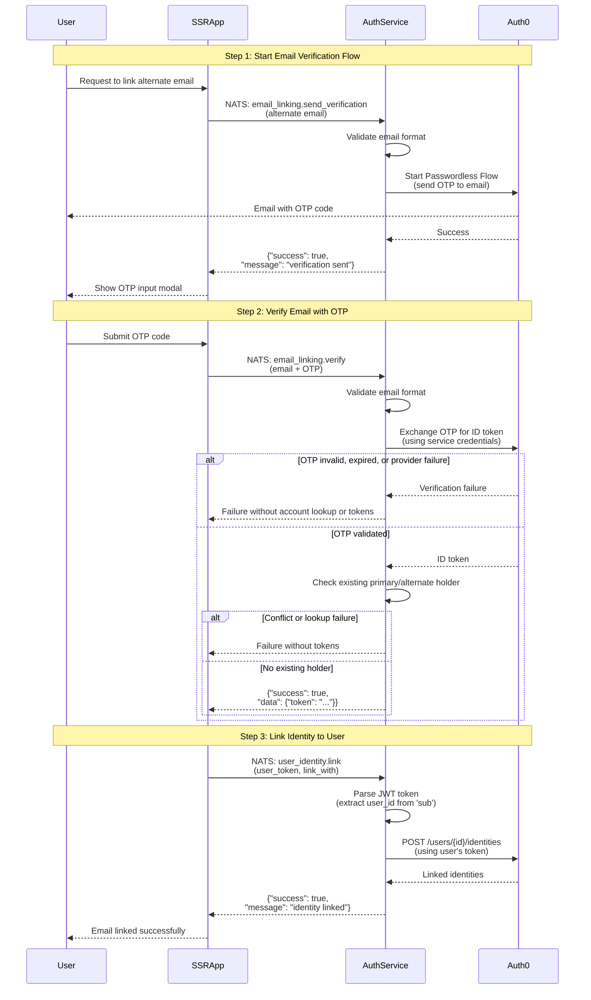
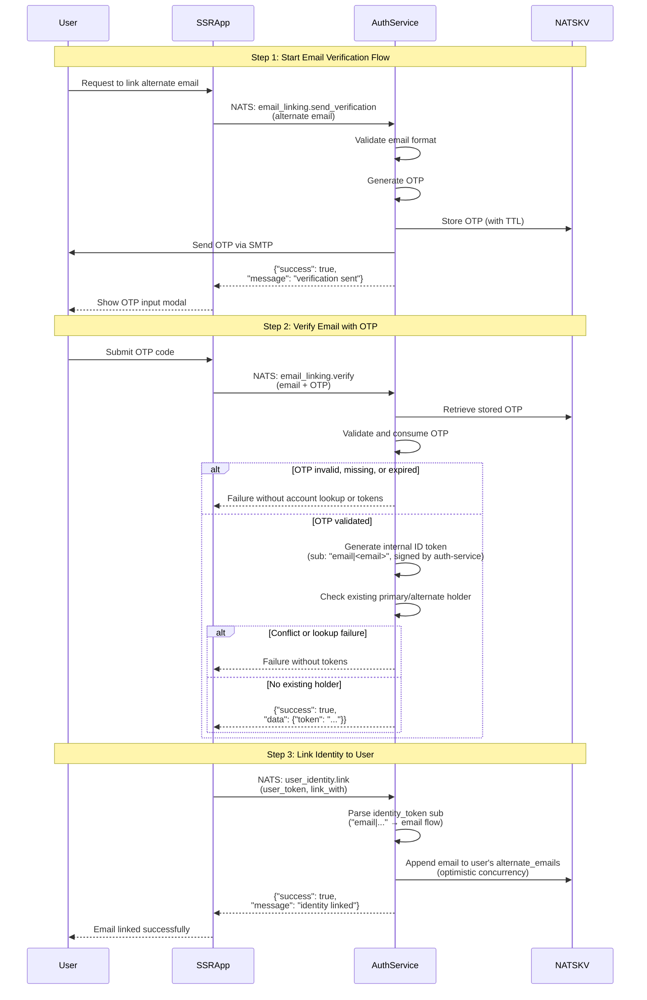

# Email Verification Flow

The auth service provides a two-step verification flow for verifying ownership of alternate email addresses. This flow validates that the user controls the email address and provides an ID token that can be used for identity linking.

## Complete Email Verification and Linking Flow

The following diagram shows the complete three-step flow for verifying an alternate email address and linking it to a user account.

> **Auth0 flow** — OTP is delivered and validated by Auth0's passwordless service.



> **Authelia flow** — OTP is generated and validated internally; no external provider call is made.



**Flow Steps:**
- **Step 1-2:** Email verification process (documented below)
- **Step 3:** Identity linking - see [Identity Linking Documentation](identity_linking.md)

---

## Step 1: Send Verification Code

To initiate the email verification process, send a NATS request to start the passwordless flow:

**Subject:** `lfx.auth-service.email_linking.send_verification`  
**Pattern:** Request/Reply

### Request Payload

The request payload should be a plain text email address (no JSON wrapping required):

```
alternate-email@example.com
```

### Reply

For an eligible, valid non-reserved address, the service requests OTP delivery without looking up whether the address is linked. Linked and unlinked addresses receive the same success confirmation under equivalent provider conditions:

**Success Reply:**
```json
{
  "success": true,
  "message": "alternate email verification sent"
}
```

Send does not return an already-linked conflict. Invalid input, reserved alias domains, missing dependencies, and genuine provider delivery/rate-limit failures still return failures; success is not fabricated when dispatch fails.

**Error Reply (Reserved Domain):**

Addresses on a domain listed in `ALLOWED_ALIAS_DOMAINS` are system-managed and can only be claimed through [`add_alias`](alias.md); no verification code is sent for them.

```json
{
  "success": false,
  "error": "email domain is reserved for system-managed aliases"
}
```

**Error Reply (Invalid Email):**
```json
{
  "success": false,
  "error": "alternate email is required"
}
```

### Example using NATS CLI

```bash
# Send verification code to alternate email
nats request lfx.auth-service.email_linking.send_verification "alternate-email@example.com"

# Expected response: {"success":true,"message":"alternate email verification sent"}
```

**Important Notes:**
- No address lookup occurs during send; an account-search outage does not block dispatch, but an unconfigured reader still returns `auth_service_unavailable`. A missing email handler still returns `email service unavailable`.
- Input is trimmed and lowercased, and send accepts only bare email addresses; display-name and quoted forms are rejected.
- OTP expiry, resend, and attempt limits remain provider-controlled.

---

## Step 2: Verify Email with OTP

After receiving the OTP code via email, verify the email address by exchanging the OTP for authentication tokens:

**Subject:** `lfx.auth-service.email_linking.verify`  
**Pattern:** Request/Reply

### Request Payload

The request payload must be a JSON object containing the email address and the OTP code:

```json
{
  "email": "alternate-email@example.com",
  "otp": "123456"
}
```

### Required Fields

- `email`: The email address that received the verification code
- `otp`: The one-time password code sent to the email

### Reply

The service validates the OTP first. Incorrect, missing, expired, or provider-rejected codes return the provider failure without any account lookup, regardless of linked state. Only after successful OTP proof does the service check alternate then primary holders (stopping at a conflict or lookup error). Tokens are returned only if both verification and the holder check succeed:

**Success Reply:**
```json
{
  "success": true,
  "data": {
    "token": "eyJhbGciOiJSUzI1NiIsInR5cCI6IkpXVCJ9..."
  }
}
```

The returned token is an authentication token that can be used to link the verified email to the user's account.

**Error Reply (Invalid OTP):**
```json
{
  "success": false,
  "error": "failed to exchange OTP for token"
}
```

**Error Reply (Email Already Linked — only after successful OTP validation):**
```json
{
  "success": false,
  "error": "email already linked"
}
```

> **Note:** The `error` text is a human-readable diagnostic, **not** a stable contract — the exact wording can vary by provider (for example, the mock provider returns `alternate email already linked` for this same condition). Consumers should branch on the `success: false` flag, not on the exact error string.

A post-proof conflict or lookup failure contains no token data. The successful OTP has already been consumed: request a fresh code before retrying after the conflict is resolved or the lookup service recovers. Discarded tokens are not cached, returned, or reused.

**Error Reply (Reserved Domain):**

Codes for addresses on a domain listed in `ALLOWED_ALIAS_DOMAINS` are never exchanged; those addresses can only be claimed through [`add_alias`](alias.md).

```json
{
  "success": false,
  "error": "email domain is reserved for system-managed aliases"
}
```

**Error Reply (Invalid Request):**
```json
{
  "success": false,
  "error": "failed to unmarshal email data"
}
```

### Example using NATS CLI

```bash
# Verify the alternate email with OTP code
nats request lfx.auth-service.email_linking.verify '{
  "email": "alternate-email@example.com",
  "otp": "123456"
}'

# Expected response: {"success":true,"data":{"token":"eyJhbG..."}}
```

**Important Notes:**
- OTP codes are time-sensitive and available for a valid time period
- Conflict lookup follows successful OTP validation; wrong/expired-code failures do not reveal linked state.
- Existing validation, reserved-domain guards, dependency-unavailable responses, and authenticated linking permissions are unchanged.
- The returned token (ID token) can be used to link the verified email to the user account using the identity linking operation (see [Identity Linking Documentation](identity_linking.md))
- For detailed Auth0-specific implementation details and technical information about the passwordless flow, see: [`../../internal/infrastructure/auth0/README.md`](../../internal/infrastructure/auth0/README.md)

---

## Implementation Notes by Provider

### Auth0

The OTP is delivered via Auth0's passwordless email flow. After verification, Auth0 issues tokens to the service; they are returned to the caller only after the post-proof holder check succeeds. The ID token can then be passed to `user_identity.link`.

A new standalone passwordless profile has a primary `email` identity, not a linked secondary identity with `profileData`, so it does not itself count as a canonical/linked holder. Verified database-primary and linked-passwordless holders still count as conflicts. See [Auth0 account linking](https://auth0.com/docs/manage-users/user-accounts/user-account-linking).

A post-proof conflict on an address held by a database account may leave the standalone passwordless profile Auth0 created during the OTP exchange. Holder lookups ignore it, and the service does not delete it.

Live delivery also depends on tenant configuration: Auth0's **Disable Sign Ups** setting can prevent new-user delivery. This change does not alter that configuration, delivery errors, or provider limits. See [Auth0 email OTP configuration](https://auth0.com/docs/authenticate/passwordless/authentication-methods/email-otp).

### Authelia

The Authelia flow is fully self-contained — no external provider is called:

1. **Send verification** (`email_linking.send_verification`): The auth-service generates a random OTP, emails it via the configured SMTP sender, and stores the OTP in the NATS KV email-OTP bucket with a TTL.
2. **Verify OTP** (`email_linking.verify`): The auth-service validates and consumes the stored OTP from NATS KV. On success, it generates an **internal ID token** (signed with the auth-service's own key); the orchestration layer then checks existing holders before returning it. The token has:
   - `email` claim set to the verified email address
   - `sub` claim set to `email|<email-address>`
3. **Link identity** (`user_identity.link`): The `sub` prefix `email|` signals the email flow — the verified email is appended to the user's `alternate_emails` in NATS KV using optimistic concurrency.

### Mock

The Mock flow is fully self-contained — no NATS KV or SMTP is involved:

1. **Send verification** (`email_linking.send_verification`): Generates a 6-digit OTP for eligible linked and unlinked addresses, stored in-memory with a 5-minute TTL. The OTP is logged to stdout (no email is sent).
2. **Verify OTP** (`email_linking.verify`): Checks the submitted code before inspecting linked state. A valid code is consumed before the existing primary/alternate conflict check; no token is generated on conflict. Otherwise, generates an **internal ID token** with `sub: "email|<email-address>"` — identical sub format to the Authelia flow.
3. **Link identity** (`user_identity.link`): Refused — the mock cannot verify tokens, so it rejects link requests. Steps 1–2 still work for local testing of the OTP exchange.

> The Mock provider returns `alternate email already linked` (rather than `email already linked`) for an already-linked address — see the note under the error replies above.

## Security Rationale and Frontend Boundary

This is the auth-service follow-up to [linuxfoundation/lfx-self-serve-ops#443](https://github.com/linuxfoundation/lfx-self-serve-ops/issues/443), tracked in [#504](https://github.com/linuxfoundation/lfx-self-serve-ops/issues/504). BFF response masking alone cannot deliver an OTP if the upstream service rejects a linked address first. Sending without account lookup and validating the OTP before conflict disclosure removes that pre-proof account-state signal.

This contract applies to NATS callers. The current Self Serve BFF masks verification failures, including post-proof conflicts, to generic HTTP 400 responses. Restoring specific frontend conflict guidance is deferred; this auth-service change does not promise a browser-visible explanation. A later link-time conflict is a separate response.
